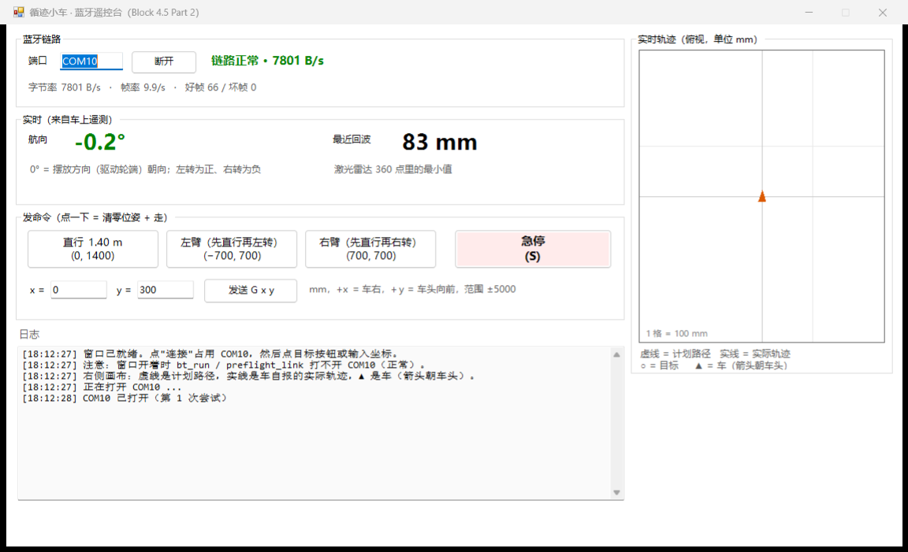

# F446RE Differential-Drive Navigation Car

**Block 4.5 Part 2 — "Sense → Think → Act" on a bare-metal MCU turned real-time system.**
STM32F446RE · FreeRTOS 10.3.1 (CMSIS-RTOS v2) · 8 threads · 3 queues · 1 binary
semaphore · 1 priority-inheritance mutex.

Send a target coordinate over **Bluetooth**; the car generates an axis-aligned
path, tracks it with a 10 ms PID loop on wheel-encoder odometry and a gyro
heading, and stops on its own at the destination. The LiDAR pipeline, the OLED
panel and the binary telemetry keep running throughout — nothing is paused for
the demo.

> **Headline numbers** — 10.00 ms control period, **42 µs jitter**, **11 µs**
> worst-case execution time, **zero** overruns; IMU sampling **100 /s** driven by
> a timer-interrupt semaphore; longest I2C critical section **2.4 ms** on a bus
> shared by the IMU and the display; Bluetooth link at **7.5 kB/s** with a 0.5 %
> spread over 60 s; heading error on all three acceptance trials **≤ 1°**.
>
> **Honest gap**: the *physical* endpoint error of the axis-aligned path has not
> been tape-measured yet (see [Known limitations](#known-limitations)). The
> numbers that do exist are labelled with their measurement date.

*Chinese version: [README.zh-CN.md](README.zh-CN.md).*

---

## What it does

The assignment defines a **cross-shaped track**: start in the centre, three arms
of tape, three commanded targets:

| Trial | Bluetooth command | Path the car must take | Target |
|---|---|---|---|
| 1 | `G 0 1400` | straight along +y | (0, 1400) mm |
| 2 | `G -700 700` | straight 700 → **turn left 90°** → straight 700 | (−700, 700) mm |
| 3 | `G 700 700` | straight 700 → **turn right 90°** → straight 700 | (700, 700) mm |

The path shape is part of the demonstration, not an implementation detail: the
car drives **straight first, then turns**, following the corridors of the cross.
A straight line from start to target would make the controller pivot first and
cut diagonally across the arms, which is the wrong trajectory for this track.



*The PC-side console (`demo\demo_ui.cmd`): it holds the Bluetooth COM port for
the whole session, sends targets, and shows the live link byte rate, frame rate,
heading and nearest LiDAR return. Bytes-per-second is the objective link test —
the module LED and the Windows "connected" tile are not.*

---

## System architecture

```
   BT COM10 --"G 0 1400\n"--> UART5 --DMA1_S0--> bt_rx.c --semaphore--> BT RX task
                                                                          | Q_Cmd (4x8B, overwrite oldest)
                                                                          v
                                                                   PathGen task (100 mm, axis-aligned L)
                                                                          | Q_Path (16x8B, producer blocks)
                                                                          v
  TIM1/TIM8 hardware QEP --> Pose task -----------------------------> PID+Motor task (10 ms)
  MPU-6500 --I2C1 (mutex)--> imu.c gyro --> pose.c                        | one compute, one CCR write
                                                                          v
                                                              TIM4 / TIM2 H-bridges --> wheels

  RPLidar C1 --USART3 + DMA (circular 2x1024 B)--> lidar.c --> Q_Lidar (8x12B, drop) --> LiDAR task
  Telemetry TX and OLED: 50 ms tasks; 1 Hz status block, binary frames, paged display
```

**Eight threads** (a *larger* number is a *higher* priority on Cortex-M):

| # | Thread | Prio | Stack | Period / trigger | Scheduling |
|---|---|---|---|---|---|
| 1 | `pidMotor` | 40 | 1024 | 10 ms | `osDelayUntil` |
| 2 | `imuAcq` | 37 | 1024 | 10 ms | counting semaphore (TIM6) |
| 3 | `pose` | 36 | 768 | 10 ms | `osDelayUntil` |
| 4 | `lidarProc` | 34 | 1536 | ~22 ms / block | `Q_Lidar` (100 ms guard) |
| 5 | `pathGen` | 30 | 1024 | command arrival | `Q_Cmd` |
| 6 | `btRx` | 28 | 768 | byte arrival | counting semaphore |
| 7 | `btTx` | 22 | 1024 | 50 ms | `osDelayUntil` |
| 8 | `oled` | 20 | 2048 | 50 ms | `osDelayUntil` |

**Why eight and not the ten in the course reference table** — the question the
TA always asks:

- **Encoder capture is not a thread.** TIM1/TIM8 are *hardware quadrature
  decoders*; the counts accumulate in the peripheral. The Pose task reads `CNT`
  once per 10 ms. There is no hand-over, so there is nothing to queue.
- **PID and Motor Control are one task.** The course text allows "related 10 ms
  functions may share a coordinated task". Merging them makes the setpoint a
  local variable: no queue, no latency, one CCR write per cycle. The price is
  that the worst case must be measured for the pair together — which it is.

**Three queues, each with a different overflow policy:**

| Queue | Depth | Message | Full → |
|---|---|---|---|
| `Q_Lidar` | 8 | 12 B block descriptor | **drop**, count `ql` (DMA overwrites anyway) |
| `Q_Cmd` | 4 | 8 B command | **overwrite oldest**, count `qc` (the newer command is the intent) |
| `Q_Path` | 16 | 8 B waypoint | **producer blocks** 50 ms, count `qpt` (a lost waypoint is a car that stops in the wrong place) |

---

## Measured results

On the target board. Raw logs in [`tools/logs/`](tools/logs); every number below
is greppable there.

| Metric | Measured | Field |
|---|---|---|
| Motor task period / jitter / WCET | **10.00 ms / 42 µs / 11 µs** (budget 700 µs) | `M: per/jit/wc` |
| Periodic-task overruns | **0** | `ov m0 p0` |
| IMU sample rate | **100 /s** | `IMU:` |
| Longest I2C hold | **2.4 ms** with the panel fitted (1.5 ms without) | `hold` |
| LiDAR pipeline | **24–25 blocks/s**, `Q_Lidar` peak 0/8 | `blk` / `q` |
| Heap used | **17 104 / 32 768 B** | `H:` |
| Smallest free stack | **≈60 %** of the 768 B Pose stack | `STK:` |
| Failure counters | all zero (`ql qc qpt imu bt log iw`) | `CNT:` |
| Bluetooth link | **7486–7527 B/s** over 60 s, six 10 s windows, no gaps | `bt_link_check -Loop` |
| Left/right symmetry | R/L **1.03 / 1.14** (was 1.80 / 4.74 before the encoder-filter fix) | `bench_p0 -Test symmetry` |
| Priority inheritance | holder priority **11 → 13** under mutex, **11** under a binary semaphore | `i` key |

**Navigation — two generations, deliberately kept apart:**

| Path shape | Trial | Firmware endpoint | Tape | Heading | Status |
|---|---|---|---|---|---|
| straight line (old) | (0, 1400) | (1, 1388) | **≤10 mm** | +1.2° | measured 2026-11-18 |
| straight line (old) | (−700, 700) | (−685, 690) | 52 mm | +3.3° | measured 2026-11-18 |
| **axis-aligned L (current)** | all three | see note | **not measured** | **≤1°** | nine runs, 2026-11-19 |

> The two turning runs of the **old** generator show why the path shape had to
> change: the car pivoted first and drove diagonally, so the pose model ("rotate
> in place without translating") was wrong by tens of millimetres. The new L path
> does the y leg first and a single 90° pivot at the corner. It has been run
> **nine times** and always produced `accepted, 14 waypoints`, drove both legs,
> turned the correct way and stopped on its own — but the **tape** was not put on
> the floor for it, so its physical error is still unmeasured.

---

## Hardware

| Item | Connection |
|---|---|
| MCU | NUCLEO-F446RE, 168 MHz, 128 kB SRAM |
| Right motor / encoder | **PB6 / PB7** (TIM4 CH1/CH2, electrically inverted, compensated by `RIGHT_INVERT`) / **PA8 / PA9** (TIM1 QEP) |
| Left motor / encoder | **PA0 / PA1** (TIM2 CH1/CH2) / **PC6 / PC7** (TIM8 QEP) |
| IMU | MPU-6500 on I2C1 (PB8/PB9), 0x68 |
| Display | SSD1306 128×64 on I2C1, 0x3C — **shared bus with the IMU**, which is why the mutex exists |
| Bluetooth | HC-04, UART5 (PC12/PD2); Windows SPP port = **COM10** |
| Debug console | USART2 (PA2/PA3) → ST-Link VCP = **COM8** @115 200 |
| LiDAR | RPLidar C1, USART3 @460 800 + DMA1_Stream1 (PC10/PC11) |

[`Core/Inc/board_pins.h`](Core/Inc/board_pins.h) is the single source of truth for
pins, timers, DMA and NVIC priorities — no `.c` file invents its own numbers.

> **Do not swap the right motor's two power leads**: `BOARD_MOTOR_RIGHT_INVERT=1`
> already compensates for the wiring; swapping would invert it twice.

> **Drive frame**: the car is run *driven-wheels-first* (the caster trails). That
> is `BOARD_DRIVE_FRAME_REVERSED 1`, which swaps **and** negates left/right at the
> motor outputs and the encoder inputs. The boot banner prints which frame is
> compiled in. Placing the car the wrong way round does not fail loudly — the
> heading loop happily drives to the wrong place.

---

## Build

`make` is not on `PATH`; add CubeIDE's toolchain first:

```powershell
$env:PATH = "D:\CubeIDE\STM32CubeIDE_2.1.1\STM32CubeIDE\plugins\com.st.stm32cube.ide.mcu.externaltools.make.win32_2.2.100.202601091506\tools\bin;D:\CubeIDE\STM32CubeIDE_2.1.1\STM32CubeIDE\plugins\com.st.stm32cube.ide.mcu.externaltools.gnu-tools-for-stm32.14.3.rel1.win32_1.0.100.202602081740\tools\bin;" + $env:PATH
```

```cmd
make -C Debug -j8 all
```

Must be **0 warnings / 0 errors**. Baseline image size:

```
text    data     bss
91080     96   47808
```

Host-side unit tests (no hardware needed — any host C compiler):

```cmd
tools\host_tests\run_tests.cmd
:: 50 protocol checks + 196 path/geometry checks + 18 odometry checks
```

---

## Run it

### 1. Look at the board first

```cmd
tools\banner.cmd            :: reset over SWD, print the two boot lines (no flashing)
tools\flash_and_monitor.cmd :: flash + verify + 15 s capture
tools\flash_and_monitor.cmd -Probe         :: probe only
tools\serial_console.cmd    :: live 1 Hz console, keys s/g/f/b/l/r/x/c/e/i/d/h
```

`tools\banner.cmd` prints a verdict, which is what you want before a demo:

```
[drive] frame: REVERSED (drives wheels-first)
Block4.5 Part2 ready imu=0 oled=0 i2c=0 bt=0 log=0
```

### 2. Drive it

```cmd
:: the one-window way (holds COM10 for the whole session)
demo\demo_ui.cmd

:: or one command per double-click
demo\demo_1_straight.cmd      :: zero pose, then G 0 1400
demo\demo_2_left.cmd          :: zero pose, then G -700 700
demo\demo_3_right.cmd         :: zero pose, then G 700 700
demo\demo_0_stop.cmd          :: S

:: command line equivalents
tools\bt_run.cmd "0 1400"     :: zero + drive, one call (negative targets: keep the quotes)
tools\bt_send.cmd "S"         :: single command
tools\bt_link_check.cmd       :: prove the link (prints bytes/s, 0 B/s = dead)
```

Frame convention: **+y is forward, +x is the car's right**, millimetres, ±5000.
Every `G` is preceded by `Z` (zero pose and path), so the car must be standing at
the start point with its **driven-wheel end along the tape** before you send it.

### 3. Bench tools

```cmd
tools\bench_p0.cmd -Test battery      :: power health
tools\bench_p0.cmd -Test symmetry     :: wheel symmetry (wheels off the ground)
tools\nav_run.cmd -Only 0,1400        :: tethered run, reads the endpoint pose back over COM8
```

### What a fresh clone can and cannot do

The repository is public: **all source, scripts and documents are readable**.

*Running* it needs the hardware and a locally built image:

| | |
|---|---|
| Read the code / report / scripts | works out of the box |
| Build | needs STM32CubeIDE's `make` + `arm-none-eabi` on `PATH`; `Debug/` is git-ignored, so **no prebuilt `.elf` ships with the repo** |
| Flash / drive | needs the board: ST-Link, the HC-04 paired as a COM port, the ST-Link VCP as another |
| Port numbers | `COM8` (console) and `COM10` (Bluetooth) are **defaults, not discoveries** — every tool accepts `-Port COMx` |
| Scripts | `.cmd` launchers + PowerShell; on Linux/macOS call the `.ps1` with `pwsh` |
| Wiring | the tools assume exactly the map in [`Core/Inc/board_pins.h`](Core/Inc/board_pins.h): 2 motors, 2 encoders, IMU, OLED, LiDAR, HC-04 |

So the scripts are reusable elsewhere, but not by double-clicking: they are tuned
to this car's port names and this machine's toolchain layout.

---

## Reading the 1 Hz block

Seven lines per second, everything prefixed `[1s]`:

```
[1s] L: blk24 q0/8 p2435 | M: per10.00 jit42 wc11 | C: q0/4
[1s] P: eh90.0 ex0 ey0 | QP: 0 | PATH: g0 r0
[1s] I2C: ok2516 err0 hold2.4ms | H: 17104/32768 | WD: 0 | IMU: 100/s
[1s] STK: 680 504 464 1280 768 576 636 1096
[1s] T10: m10.00/42/11 p11.38/1383/12 | ov m0 p0
[1s] T50: b51.26/1266/1116 o51.11/1114/17374 | ov b0 o0
[1s] CNT: ql0 qc0 qpt0 imu0 bt(s0 r0 o0 u0) log0 iw0
```
| Line | Meaning |
|---|---|
| 1 | LiDAR block rate / `Q_Lidar` peak / worst parse time; motor period, jitter, WCET; `Q_Cmd` depth |
| 2 | Pose `eh` (0.1°), `ex`/`ey` (mm); `Q_Path` depth; **cumulative** waypoints generated/reached |
| 3 | I2C ok/err/longest hold; heap; watchdog (deliberately off); measured IMU rate |
| 4 | Free stack for the eight tasks (PID/IMU/Pose/LiDAR/Path/BTRX/BTTX/OLED) |
| 5–6 | period/jitter/WCET and overruns for the four periodic tasks |
| 7 | Failure counters — **all zero is healthy** |

Two numbers that look bad and are not:

- **Pose shows 11.38 ms, not 10 ms.** The IMU task's blocking I2C transaction
  (≤1.5 ms, higher priority) pushes it. The pose the PID uses is at most one
  cycle old, which does not matter for a 120 mm/s car.
- **OLED WCET is ~17 ms** with the panel fitted, against a 3 ms budget. The task
  is lowest priority and has a 50 ms slot, so it never delays the control loop —
  but it is a real number and it is in the report rather than hidden.

---

## Bugs that will come back if this is rewritten

Every one of these was found on the real board, and every one reproduces if the
fix is lost. Symptom → root cause → fix. Full write-ups in report §11.

| # | Symptom | Root cause | Fix |
|---|---|---|---|
| A | seven banners print, then the whole car freezes while TIM7 keeps ticking | the stack-overflow hook sets BASEPRI=0x50, which cannot mask priority-0 TIM7 | stacks 512→1024, 1024→2048 |
| B | `G` generates waypoints but the car never moves | `osEventFlagsWait` returns `0xFFFFFFFD` for "no event"; `& 1 == 1` read that as STOP | test `flags & 0x80000000` first |
| C | right wheel spins backwards on `f`, car pivots on the spot | the motor is on PB6/PB7 but fitted on the right, and its polarity is inverted | swap the two groups in `board_pins.h`, keep `RIGHT_INVERT` |
| D | 28 % of the commanded speed | integral clamp 120 × ki 0.15 = 2 % of the output, i.e. no integral at all | retune kp/ki/clamp together |
| E | queue empty right after `G` | the test script's late `S` cleared the freshly generated path | let the command arrive before closing the port |
| F | right wheel 0.5× forward but 4.7× reverse | QEP input filter was 190 ns, so brush noise counted as edges | 3 µs filter in `encoder.c` |
| G | a 1.4 m run reported "complete" after 1.2 s | `PATH: g/r` are cumulative since boot, not per-run | `QP == 0` plus pose-at-target |
| H | after a battery cold start the banner reads `imu=-1`, heading falls back to the wheels, `iw` climbs at 10/s | the IMU init window was 5×20 ms and the MPU-6500 needs ~100 ms of stable supply; a missed window is not recoverable | retry for ~1 s and always start TIM6 (the cadence is a system resource, not a property of the sensor) |

---

## Known limitations

Deliberately listed so nothing here reads as better than it is.

| Item | State |
|---|---|
| **Physical endpoint error of the L path** | **not tape-measured.** Nine runs, correct shape, correct heading (≤1°), endpoint 待实测 |
| Wheel track width | `130 mm` is an **assumption**, never caliper-measured. It is the dominant term in the turning error |
| IWDG | **not enabled** (`WD: 0` is deliberate). The standard asks for health-gated feeding |
| Stall protection, battery voltage monitoring | not implemented |
| Bluetooth downlink | no acknowledgements for `G`/`S`; the link is command-down, telemetry-up |
| Reversed drive frame | one 300 mm closed-loop run; not validated at full scale |
| `HEADING` source | gyro zero is taken at power-up, so the car must stand still for 1–2 s after power-on |

Two physical facts worth stating before anyone is surprised by them:

- **The dead band grows with load.** 20–30 % duty does not move the wheels
  unloaded, and 40 % cannot move the car on the floor with a weak pack. The
  navigation loop is closed, so it copes; open-loop jog keys do not.
- **Translation during a pivot is not modelled.** The pose assumes the car
  rotates about the axle centre without translating. Friction and the unverified
  track width break that assumption by tens of millimetres, which is exactly the
  residual the tape measures on turning trials.

---

## Repository layout

```
Core/Src/app_rtos.c     8 threads, 3 queues, 1 Hz status block, role-5 demo
Core/Src/app.c          boot order, NVIC priority table, HAL dispatch
Core/Src/path.c         axis-aligned (straight → 90° → straight) waypoints + heading law
Core/Src/motor.c        TIM4/TIM2 PWM + dual PID + drive-frame mapping
Core/Src/encoder.c      TIM1/TIM8 hardware QEP (3 µs input filter)
Core/Src/pose.c         odometry + gyro heading (gyro first, wheels as fallback)
Core/Src/imu.c          MPU-6500, sampled in task context
Core/Src/i2c_bus.c      sole owner of I2C1: priority-inheritance mutex, bounded transfers
Core/Src/oled.c         SSD1306 driver, 16-byte chunks so the lock stays short
Core/Src/telemetry.c    binary frames over UART5 (Bluetooth), DMA1_Stream7
Core/Inc/board_pins.h   single source of truth for pins/timers/DMA/NVIC
tools/                  banner / drive_ui / bt_link_check / bt_run / bench_p0 / nav_run / host tests
demo/                   double-click launchers (no typing needed on stage)
Docs/                   design report, demo material, coding standards, handover
pc_app/                 PC point-cloud viewer (Python + matplotlib)
```

## Documentation

| Document | Contents |
|---|---|
| [`Docs/Block4.5_Part2_Design_Report_CN.docx`](Docs/Block4.5_Part2_Design_Report_CN.docx) | design report: architecture argument, measured numbers, eight bugs, open items |
| [`Docs/Block4.5_Part2_Demo_Script_CN.docx`](Docs/Block4.5_Part2_Demo_Script_CN.docx) | demo script with Q&A |
| [`Docs/Block4.5_Part2_Demo_Flowcard_CN.docx`](Docs/Block4.5_Part2_Demo_Flowcard_CN.docx) | one-page flowcard |
| [`Docs/CODING_STANDARDS.md`](Docs/CODING_STANDARDS.md) | the rules this code was written against |
| [`Docs/HANDOVER.md`](Docs/HANDOVER.md) | on-hardware record: bug scenes, debugging technique |
| [`Docs/NEXT_SESSION.md`](Docs/NEXT_SESSION.md) | current state, open items, next steps |

## Third-party components

- FreeRTOS 10.3.1 + the CMSIS-RTOS v2 wrapper (ST)
- STM32F4 HAL
- `pc_app/`: PC point-cloud viewer (Python + matplotlib, decodes the binary telemetry)

Course example code and lecture material are **not** part of this repository.
