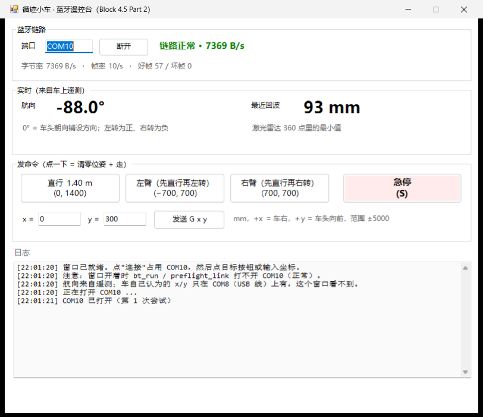

# F446RE 双轮差速导航小车

**Block 4.5 Part 2 —— 在裸机 MCU 上把 Sense → Think → Act 做成真正的实时系统。**
STM32F446RE · FreeRTOS 10.3.1（CMSIS-RTOS v2）· 8 线程 · 3 队列 · 1 个二值信号量 ·
1 把带优先级继承的互斥量。

蓝牙下发一个目标坐标，车自己生成**轴对齐路径**，用编码器里程计 + 陀螺航向做 10 ms
PID 闭环，到点自己停。激光流水线、OLED 面板和二进制遥测**全程不停**——没有为了演示
而暂停任何东西。

> **亮点数字** —— 控制周期 **10.00 ms**、抖动 **42 µs**、最坏执行 **11 µs**、超时计数 **0**；
> IMU 由定时器中断信号量驱动，实测 **100 /s**；IMU 与屏幕共享的 I2C 总线最长持锁
> **2.4 ms**；蓝牙链路 **7.5 kB/s**、60 秒波动 **0.5 %**；三趟验收航向误差 **≤1°**。
>
> **诚实的缺口**：轴对齐路径的**物理端点误差还没用卷尺量过**（见「已知限制」）。
> 已有的数字都标了测量日期。

*English version: [README.md](README.md).*

---

## 它做什么

作业给的是**十字形场地**：起点在中心，三条胶带臂，三个目标点：

| 趟 | 蓝牙命令 | 车应该走的路径 | 目标点 |
|---|---|---|---|
| 1 | `G 0 1400` | 沿 +y 直行 | (0, 1400) mm |
| 2 | `G -700 700` | 直行 700 → **左转 90°** → 直行 700 | (−700, 700) mm |
| 3 | `G 700 700` | 直行 700 → **右转 90°** → 直行 700 | (700, 700) mm |

**路径形状本身就是要演示的东西**，不是实现细节：车必须**先直行、再转弯**，沿十字的走廊走。
如果生成"起点到终点的一条直线"，控制器会先原地转再斜着切过两臂——那是错的轨迹。



*PC 侧遥控台（`demo\demo_ui.cmd`）：整个会话占住蓝牙串口，发目标点，同时显示实时链路字节率、
帧率、航向和最近回波。**判据是字节率**，不是模块的灯，也不是 Windows 的"已连接"。*

---

## 系统架构

```
   蓝牙 COM10 --"G 0 1400\n"--> UART5 --DMA1_S0--> bt_rx.c --信号量--> BT RX 任务
                                                                        │ Q_Cmd（4×8B，满则覆盖最旧）
                                                                        v
                                                                  PathGen 任务（100 mm，轴对齐 L 形）
                                                                        │ Q_Path（16×8B，生产方阻塞）
                                                                        v
  TIM1/TIM8 硬件 QEP --> Pose 任务 -------------------------------> PID+Motor 任务（10 ms）
  MPU-6500 --I2C1（互斥量）--> imu.c 陀螺 --> pose.c                     │ 一次算完，一次写 CCR
                                                                        v
                                                              TIM4 / TIM2 H 桥 --> 左右轮

  RPLidar C1 --USART3 + DMA（循环 2×1024 B）--> lidar.c --> Q_Lidar（8×12B，满则丢）--> 激光任务
  遥测发送与 OLED：50 ms 任务；1 Hz 状态块、二进制帧、分页刷新
```

**8 个线程**（Cortex-M 上**数字越大优先级越低**）：

| # | 线程 | 优先级 | 栈(B) | 周期/触发 | 调度方式 |
|---|---|---|---|---|---|
| 1 | `pidMotor` | 40 | 1024 | 10 ms | `osDelayUntil` |
| 2 | `imuAcq` | 37 | 1024 | 10 ms | 计数信号量（TIM6） |
| 3 | `pose` | 36 | 768 | 10 ms | `osDelayUntil` |
| 4 | `lidarProc` | 34 | 1536 | ~22 ms / 块 | `Q_Lidar`（100 ms 守卫） |
| 5 | `pathGen` | 30 | 1024 | 命令到达 | `Q_Cmd` |
| 6 | `btRx` | 28 | 768 | 字节到达 | 计数信号量 |
| 7 | `btTx` | 22 | 1024 | 50 ms | `osDelayUntil` |
| 8 | `oled` | 20 | 2048 | 50 ms | `osDelayUntil` |

**为什么是 8 个而不是参考表的 10 个**（评委必问）：

- **编码器采集不是线程**。TIM1/TIM8 是**硬件正交解码器**，计数在外设里累加；Pose 任务每
  10 ms 读一次 `CNT`。没有"交接"，也就没有队列可言。
- **PID 与电机控制合并成一个任务**。课件原文允许 "related 10 ms functions may share a
  coordinated task"。合并后 setpoint 是任务内局部变量：零队列、零延迟、每周期只写一次
  CCR。代价是最坏情况必须**成对**测量——测了。

**3 个队列，每个的溢出策略都不同：**

| 队列 | 深度 | 消息 | 满了怎么办 |
|---|---|---|---|
| `Q_Lidar` | 8 | 12 B 块描述符 | **丢弃**，计 `ql`（DMA 本来就会覆盖） |
| `Q_Cmd` | 4 | 8 B 命令 | **覆盖最旧**，计 `qc`（新命令才代表意图） |
| `Q_Path` | 16 | 8 B 路点 | **生产方阻塞** 50 ms，计 `qpt`（丢一个点，车就停在错的地方） |

---

## 实测数据

在目标板上测的。原始日志在 [`tools/logs/`](tools/logs)，下表每个数字都能 grep 到。

| 指标 | 实测 | 字段 |
|---|---|---|
| 电机任务 周期 / 抖动 / WCET | **10.00 ms / 42 µs / 11 µs**（预算 700 µs） | `M: per/jit/wc` |
| 周期任务超时 | **0** | `ov m0 p0` |
| IMU 采样率 | **100 /s** | `IMU:` |
| I2C 最长持锁 | **2.4 ms**（接面板；不接 1.5 ms） | `hold` |
| 激光流水线 | **24–25 块/s**，`Q_Lidar` 峰值 0/8 | `blk` / `q` |
| 堆占用 | **17 104 / 32 768 B** | `H:` |
| 最小空闲栈 | Pose 任务 768 B 里还剩 **≈60 %** | `STK:` |
| 失败计数器 | 全 0（`ql qc qpt imu bt log iw`） | `CNT:` |
| 蓝牙链路 | 60 秒 6 段 **7486–7527 B/s**，无空档 | `bt_link_check -Loop` |
| 左右轮对称性 | R/L **1.03 / 1.14**（修编码器滤波前是 1.80 / 4.74） | `bench_p0 -Test symmetry` |
| 优先级继承 | 持锁者优先级 **11 → 13**（mutex）/ **11**（二值信号量） | 按 `i` |

**导航——两代路径，特意分开记：**

| 路径形状 | 趟 | 固件终点 | 卷尺 | 航向 | 状态 |
|---|---|---|---|---|---|
| 直线到目标（旧） | (0, 1400) | (1, 1388) | **≤10 mm** | +1.2° | 2026-11-18 实测 |
| 直线到目标（旧） | (−700, 700) | (−685, 690) | 52 mm | +3.3° | 2026-11-18 实测 |
| **轴对齐 L 形（现在）** | 三趟 | 见备注 | **未量** | **≤1°** | 2026-11-19 跑了 9 趟 |

> 旧生成器的两趟带转向的数据，正好说明**为什么必须改路径形状**：车先原地转、再斜着走，
> 而位姿假设"原地转不产生平移"，于是物理误差到了几十毫米。新的 L 形先走完 y 腿，在拐角
> 只做一次 90° 原地转。它**跑过 9 次**，每次都 `accepted, 14 waypoints`、两条腿都走完、
> 转向方向正确、自己停；但**没在地上放过卷尺**，所以物理误差仍是**待实测**。

---

## 硬件接线

| 项目 | 连接 |
|---|---|
| MCU | NUCLEO-F446RE，168 MHz，128 kB SRAM |
| 右电机 / 编码器 | **PB6 / PB7**（TIM4 CH1/CH2，电极性反，由 `RIGHT_INVERT` 补偿）/ **PA8 / PA9**（TIM1 QEP） |
| 左电机 / 编码器 | **PA0 / PA1**（TIM2 CH1/CH2）/ **PC6 / PC7**（TIM8 QEP） |
| IMU | MPU-6500，I2C1（PB8/PB9），地址 0x68 |
| 显示屏 | SSD1306 128×64，I2C1，地址 0x3C —— **与 IMU 共用总线**，这就是互斥量存在的理由 |
| 蓝牙 | HC-04，UART5（PC12/PD2）；Windows SPP 端口 = **COM10** |
| 调试串口 | USART2（PA2/PA3）→ ST-Link 虚拟串口 = **COM8** @115 200 |
| 激光雷达 | RPLidar C1，USART3 @460 800 + DMA1_Stream1（PC10/PC11） |

[`Core/Inc/board_pins.h`](Core/Inc/board_pins.h) 是引脚、定时器、DMA 和 NVIC 优先级的
**唯一真源**——没有任何 `.c` 文件自己编数字。

> **不要换右电机的两根动力线**：`BOARD_MOTOR_RIGHT_INVERT=1` 已经补偿了接线极性，
> 再换一次就是双重取反。

> **驱动坐标系**：现在按**驱动轮在前**跑（万向轮拖在后面），即
> `BOARD_DRIVE_FRAME_REVERSED 1`——它在电机输出和编码器输入上**同时交换并取反**左右。
> 开机横幅会打印实际生效的那一版。**车摆反了不会报错**，航向闭环会一路修正到错的地方。

---

## 编译

`make` 不在 `PATH` 里，先把 CubeIDE 的工具链加进去：

```powershell
$env:PATH = "D:\CubeIDE\STM32CubeIDE_2.1.1\STM32CubeIDE\plugins\com.st.stm32cube.ide.mcu.externaltools.make.win32_2.2.100.202601091506\tools\bin;D:\CubeIDE\STM32CubeIDE_2.1.1\STM32CubeIDE\plugins\com.st.stm32cube.ide.mcu.externaltools.gnu-tools-for-stm32.14.3.rel1.win32_1.0.100.202602081740\tools\bin;" + $env:PATH
```

```cmd
make -C Debug -j8 all
```

必须 **0 warning / 0 error**。基线镜像大小：

```
text    data     bss
91080     96   47808
```

主机侧单元测试（不需要硬件，任意主机 C 编译器）：

```cmd
tools\host_tests\run_tests.cmd
:: 协议 50 项 + 路径几何 196 项 + 里程计 18 项
```

---

## 跑起来

### 1. 先看板子

```cmd
tools\banner.cmd            :: 通过 SWD 复位并打印两行开机信息（不烧录）
tools\flash_and_monitor.cmd :: 烧录 + 校验 + 抓 15 s
tools\flash_and_monitor.cmd -Probe         :: 只探测
tools\serial_console.cmd    :: 实时 1 Hz 终端，按键 s/g/f/b/l/r/x/c/e/i/d/h
```

`tools\banner.cmd` 会直接给判读，这就是演示前该看的东西：

```
[drive] frame: REVERSED (drives wheels-first)
Block4.5 Part2 ready imu=0 oled=0 i2c=0 bt=0 log=0
```

### 2. 让车走

```cmd
:: 一个窗口搞定（全程占住 COM10）
demo\demo_ui.cmd

:: 或者每趟双击一条
demo\demo_1_straight.cmd      :: 清零位姿 → G 0 1400
demo\demo_2_left.cmd          :: 清零位姿 → G -700 700
demo\demo_3_right.cmd         :: 清零位姿 → G 700 700
demo\demo_0_stop.cmd          :: S 急停

:: 命令行等价物
tools\bt_run.cmd "0 1400"     :: 清零 + 走，一条命令（负坐标要带引号）
tools\bt_send.cmd "S"         :: 单条命令
tools\bt_link_check.cmd       :: 证明链路通（打印字节率，0 B/s = 死了）
```

坐标约定：**+y = 前进方向（当前是驱动轮那一端），+x = 前进方向的右侧**，单位 mm，范围 ±5000。
每条 `G` 之前都会先发 `Z`（位姿 + 路径清零），所以发命令前车必须已经站在起点、
且**驱动轮那端**沿着胶带。

### 3. 台架工具

```cmd
tools\bench_p0.cmd -Test battery      :: 电源健康度
tools\bench_p0.cmd -Test symmetry     :: 左右对称性（轮子要架空）
tools\nav_run.cmd -Only 0,1400        :: 带线跑，从 COM8 读回终点位姿
```

---

## 看懂 1 Hz 状态块

每秒 7 行，都带 `[1s]` 前缀：

```
[1s] L: blk24 q0/8 p2435 | M: per10.00 jit42 wc11 | C: q0/4
[1s] P: eh90.0 ex0 ey0 | QP: 0 | PATH: g0 r0
[1s] I2C: ok2516 err0 hold2.4ms | H: 17104/32768 | WD: 0 | IMU: 100/s
[1s] STK: 680 504 464 1280 768 576 636 1096
[1s] T10: m10.00/42/11 p11.38/1383/12 | ov m0 p0
[1s] T50: b51.26/1266/1116 o51.11/1114/17374 | ov b0 o0
[1s] CNT: ql0 qc0 qpt0 imu0 bt(s0 r0 o0 u0) log0 iw0
```

| 行 | 含义 |
|---|---|
| 1 | 激光块率 / `Q_Lidar` 峰值 / 最坏解析时间；电机周期、抖动、WCET；`Q_Cmd` 深度 |
| 2 | 位姿 `eh`（×0.1°）、`ex`/`ey`（mm）；`Q_Path` 深度；**开机累计**的路点生成/到达数 |
| 3 | I2C 成功/失败/最长持锁；堆；看门狗（刻意未开）；实测 IMU 速率 |
| 4 | 8 个任务的空闲栈（PID/IMU/Pose/LiDAR/Path/BTRX/BTTX/OLED） |
| 5–6 | 4 个周期任务的 周期/抖动/WCET 与超时计数 |
| 7 | 失败计数器 —— **全 0 才健康** |

两个"看着难看但没错"的数字：

- **Pose 显示 11.38 ms 而不是 10 ms**：被 IMU 任务那次阻塞式 I2C（≤1.5 ms、优先级更高）
  挤掉了。PID 用的位姿最多旧一拍，对 120 mm/s 的车没有影响。
- **接上面板后 OLED 的 WCET 约 17 ms**，而预算是 3 ms。它是最低优先级、有 50 ms 时隙，
  永远不会拖慢控制环——但这确实是个难看的数字，所以它写在报告里而不是藏起来。

---

## 重写就会复现的八个坑

每一个都是在真板子上抓到的，修法丢了就会原样回来。症状 → 根因 → 修法，完整过程在报告 §11。

| # | 症状 | 根因 | 修法 |
|---|---|---|---|
| A | 打印 7 个横幅后整车假死，但 TIM7 还在跳 | 栈溢出钩子设 BASEPRI=0x50，屏蔽不掉优先级 0 的 TIM7 | 栈 512→1024、1024→2048 |
| B | `G` 生成了路点但车不动 | `osEventFlagsWait` 无事件返回 `0xFFFFFFFD`，`& 1 == 1` 被当成 STOP | 先判 `flags & 0x80000000` |
| C | `f` 时右轮倒转，车原地打转 | 电机在 PB6/PB7 上但装的是右轮，且极性反 | `board_pins.h` 两组对调，保留 `RIGHT_INVERT` |
| D | 速度只有目标的 28 % | 积分限幅 120 × ki 0.15 = 输出量程的 2 %，积分等于禁用 | kp/ki/限幅一起重新整定 |
| E | `G` 之后队列立刻空了 | 测试脚本晚到的 `S` 清掉了刚生成的路径 | 发完命令等送达再关串口 |
| F | 右轮正转 0.5×、反转 4.7× | QEP 输入滤波只有 190 ns，碳刷噪声被当边沿 | `encoder.c` 改 3 µs |
| G | 1.4 m 的路 1.2 s 就判"完成" | `PATH: g/r` 是开机累计值，不是本趟进度 | `QP == 0` + 位姿在目标附近 |
| H | 电池冷启动后横幅 `imu=-1`，航向退回轮式，`iw` 每秒 +10 | IMU 初始化只给 5×20 ms，而 MPU-6500 需要约 100 ms 稳定供电，错过窗口不可恢复 | 重试到约 1 秒；TIM6 **无条件**启动（节拍是系统资源，不是传感器的属性） |

---

## 已知限制

刻意列出来，免得哪一条被读成"比实际更好"。

| 项 | 状态 |
|---|---|
| **L 形路径的物理端点误差** | **未用卷尺量**。9 趟形状正确、航向 ≤1°，端点**待实测** |
| 轮距 | `130 mm` 是**假定值**，从未用卡尺量过。它是转向误差的主导项 |
| IWDG | **未启用**（`WD: 0` 是刻意的）。规范要求健康门控喂狗 |
| 堵转保护、电池电压监测 | 未实现 |
| 蓝牙下行 | `G`/`S` 没有应答；链路是"命令下行、遥测上行" |
| 反向驱动坐标系 | 只跑过一趟 300 mm 的闭环，满距离未验证 |
| 航向来源 | 陀螺零位取自上电瞬间，所以上电后车要静止 1–2 秒 |

两个物理事实，先说在前面，免得被数字误导：

- **死区随负载变大**。空载 20–30 % 占空比不转；弱电池下 40 % 也推不动车。导航是闭环所以
  不受影响，但开环点动键在这种情况下不可用。
- **原地转的平移没有被建模**。位姿假设车绕轮轴中心纯旋转、不平移；摩擦和未标定的轮距
  会让车体平移几十毫米——这正是卷尺在转向趟上量到的那部分残差。

---

## 仓库结构

```
Core/Src/app_rtos.c     8 线程、3 队列、1 Hz 状态块、角色 5 演示
Core/Src/app.c          启动顺序、NVIC 优先级表、HAL 分发
Core/Src/path.c         轴对齐（直行→90°→直行）路点 + 航向控制律
Core/Src/motor.c        TIM4/TIM2 PWM + 双轮 PID + 驱动坐标系映射
Core/Src/encoder.c      TIM1/TIM8 硬件 QEP（3 µs 输入滤波）
Core/Src/pose.c         里程计 + 陀螺航向（陀螺优先，轮式兜底）
Core/Src/imu.c          MPU-6500，任务上下文采样
Core/Src/i2c_bus.c      I2C1 唯一所有者：优先级继承互斥量、有界事务
Core/Src/oled.c         SSD1306 驱动，16 字节分块，把持锁压到 2.4 ms
Core/Src/telemetry.c    UART5（蓝牙）二进制帧，DMA1_Stream7
Core/Inc/board_pins.h   引脚/定时器/DMA/NVIC 的唯一真源
tools/                  banner / drive_ui / bt_link_check / bt_run / bench_p0 / nav_run / 主机测试
demo/                   双击快捷方式（现场不用打字）
Docs/                   设计报告、演示材料、编码规范、交接文档
pc_app/                 PC 点云窗口（Python + matplotlib）
```

## 文档

| 文档 | 内容 |
|---|---|
| [`Docs/Block4.5_Part2_Design_Report_CN.docx`](Docs/Block4.5_Part2_Design_Report_CN.docx) | 设计报告：架构论证、实测数字、八个 bug、待办 |
| [`Docs/Block4.5_Part2_Demo_Script_CN.docx`](Docs/Block4.5_Part2_Demo_Script_CN.docx) | 演示脚本 + 问答 |
| [`Docs/Block4.5_Part2_Demo_Flowcard_CN.docx`](Docs/Block4.5_Part2_Demo_Flowcard_CN.docx) | 一页纸流程卡 |
| [`Docs/CODING_STANDARDS.md`](Docs/CODING_STANDARDS.md) | 这份代码遵循的规则 |
| [`Docs/HANDOVER.md`](Docs/HANDOVER.md) | 上板记录：故障现场、定位手法 |
| [`Docs/NEXT_SESSION.md`](Docs/NEXT_SESSION.md) | 当前状态、待办、下一步 |

## 第三方组件

- FreeRTOS 10.3.1 + ST 的 CMSIS-RTOS v2 封装
- STM32F4 HAL
- `pc_app/`：PC 点云窗口（Python + matplotlib，解析二进制遥测帧）

课程示例代码与课件**不在**本仓库内。
